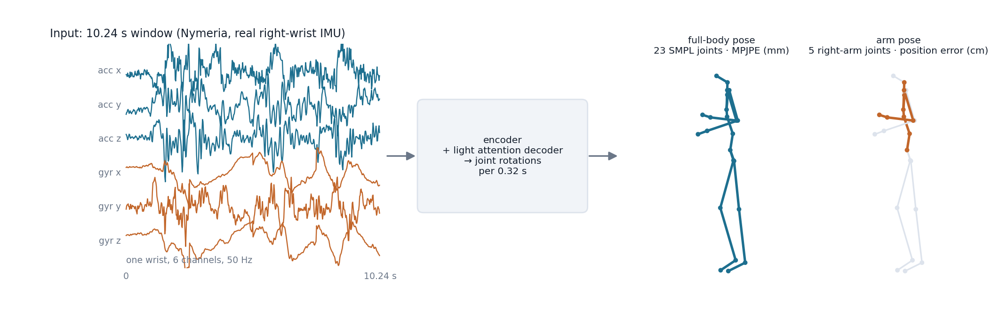
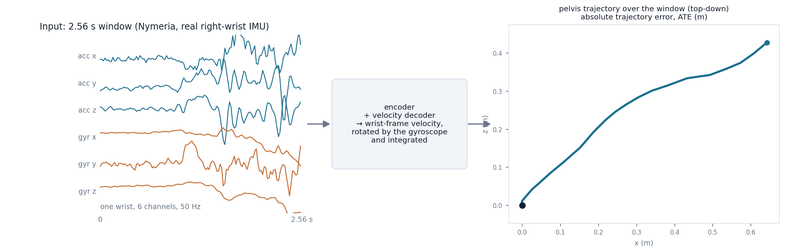
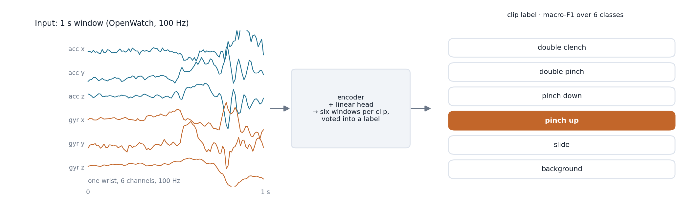
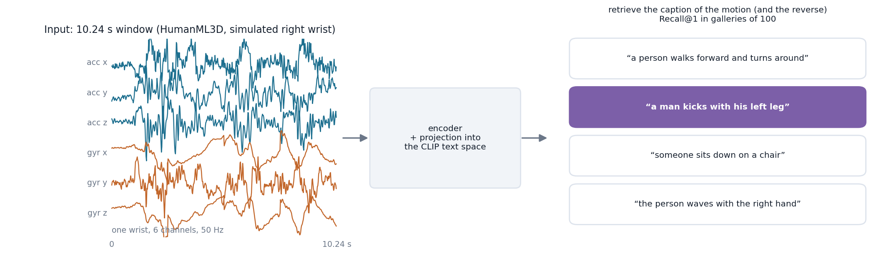
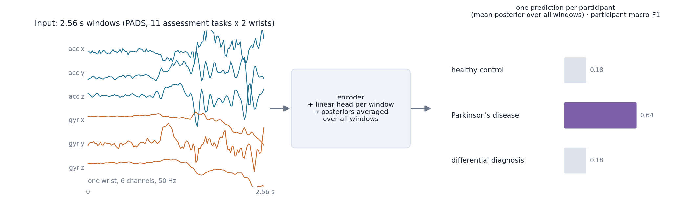
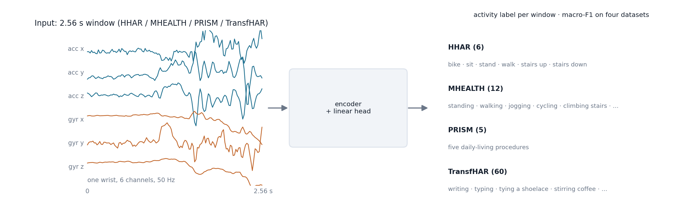

# Tasks

Ten tasks from eight datasets, in six families. Every task reads the same input, one wrist's accelerometer and
gyroscope in a forward–left–up frame, and is defined by a task card that fixes the window, the decoder, the training
recipe, the split, the selection rule and the scorer (see [Task cards](reference/task-cards.md)). The figures below
show, for each family, the input window, what the encoder and the card's decoder produce, and how it is scored.
Input traces are real Nymeria right-wrist windows; labels, captions and class scores are illustrative.

## Pose estimation

| | Arm pose `arm_pose_nymeria` | Full-body pose `full_body_pose_nymeria` |
|---|---|---|
| Dataset | Nymeria: real right-wrist IMU with Project-Aria motion capture, 300 h released | same |
| Input | 10.24 s window at 50 Hz | same |
| Output | 6-D rotations of the five right-arm joints (collar, shoulder, elbow, wrist, hand) per 0.32 s patch | 6-D rotations of the 23 SMPL body joints per 0.32 s patch; the pelvis orientation comes from ground truth |
| Decoder | width-192 attention decoder, two cross-channel and two temporal layers | width-192 attention decoder, one cross-channel layer |
| Metric | forward-kinematics position error of the five joints, cm ↓ | root-relative MPJPE over the 23 joints, mm ↓ |
| Split | by recording session (867 training, 101 evaluation sessions); participants recur | same |

Frozen features trail training from scratch on full-body pose; fine-tuning InrtlWrist reaches 88.1 mm against
92.7 mm from scratch.

## Inertial odometry

| | Inertial odometry `odometry_nymeria_local` |
|---|---|
| Dataset | Nymeria (same recordings as the pose tasks) |
| Input | 2.56 s window at 50 Hz |
| Output | pelvis velocity in the wrist frame, four values per 0.32 s patch |
| Decoder | width-192 attention decoder, one temporal layer |
| Scoring | the predicted velocities are rotated into the world frame with the ground-truth initial wrist orientation propagated by integrating the gyroscope, summed into a trajectory and compared with the pelvis trajectory: absolute trajectory error, m ↓ |
| Split | by recording session |

The protocol uses the true initial orientation and short windows, so it is easier than full inertial navigation and
its numbers are not comparable to world-frame odometry systems. Fine-tuned InrtlWrist reaches 0.154 m ATE against
0.162 m from scratch.

## Microgesture recognition

| | Microgesture `microgesture_openwatch` |
|---|---|
| Dataset | OpenWatch: five hand gestures (double clench, double pinch, pinch down, pinch up, slide) plus background, real recordings |
| Input | 1 s windows at 100 Hz, six windows per clip from a centred 2 s interval |
| Output | class logits per window; a clip is labelled by the first run of three identical window predictions, else by majority |
| Decoder | linear head |
| Metric | clip macro-F1 on the test split ↑ |
| Split | by participant over the 43 canonical identities (the release's 50 ids contain duplicated and mirrored recordings), stratified by posture |

Frozen InrtlWrist reaches 64.7 clip F1 and stays ahead of every fine-tuned matched method on this task.

## IMU–text retrieval

| | IMU–text retrieval `language_humanml3d` |
|---|---|
| Dataset | HumanML3D motions with right-wrist IMU simulated from the motion capture (UniMTS release), with captions |
| Input | 10.24 s window at 50 Hz |
| Output | an embedding aligned with the CLIP ViT-B/32 text space |
| Decoder | a projection, trained with paired motion–text supervision for every encoder alike |
| Metric | mean Recall@1 over IMU→text and text→IMU in galleries of 100 (200 random galleries on the official test split; the full gallery holds 3,701 clips) ↑ |
| Split | the official HumanML3D split; 437 of the test clips share source frames with training clips, which affects every encoder equally |

All encoders receive paired supervision during downstream training, so the task measures how well a pretrained
representation supports learning alignment, not zero-shot alignment. Under frozen probing no supervised source task
approaches the pretrained encoder here (27.9 Recall@1).

## Parkinson's disease classification

| | Parkinson's disease `pd_pads` |
|---|---|
| Dataset | PADS (PhysioNet): 469 participants, healthy control, Parkinson's disease or differential diagnosis; eleven scripted assessment steps recorded on both wrists |
| Input | 2.56 s windows at 50 Hz; each (participant, step, wrist) recording is its own single-wrist session |
| Output | class logits per window; a participant's prediction is the argmax of the mean posterior over all of that participant's windows |
| Decoder | linear head, inverse-frequency class-weighted cross-entropy |
| Metric | participant macro-F1 over the three classes ↑ (balanced accuracy is reported too) |
| Split | subject-disjoint 80/20 (375 / 94 participants) |

The participant metric is coarse: a never-trained frozen encoder reaches 51.7, so encoders within a few points of
each other are not separated by it.

## Activity recognition

| | HHAR `har_hhar` | MHEALTH `har_mhealth` | PrISM `har_prism` | TransfHAR `har_userwatch` |
|---|---|---|---|---|
| Classes | 6 | 12 | 5 global daily-living procedures | 60 everyday hand activities |
| Subjects | 9 | 10 | 31 | 10 |
| Split | subject-disjoint, 20 % held out | subject-disjoint, 20 % held out | subject-disjoint, 20 % held out | 80/20 in time within each recording, since most activities were performed by one participant |

All four use 2.56 s windows at 50 Hz, a linear head and window macro-F1 ↑; the leaderboard's activity column is the
mean over the four sets. These sets are held out of the released pretraining corpus; the activity datasets that are in
the corpus (WISDM, PAMAP2, RecoFit, SAMoSA, UT-Watch) appear in the website's per-task table for reference only.
